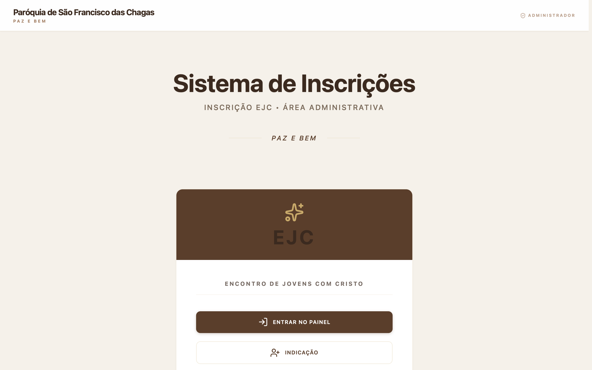
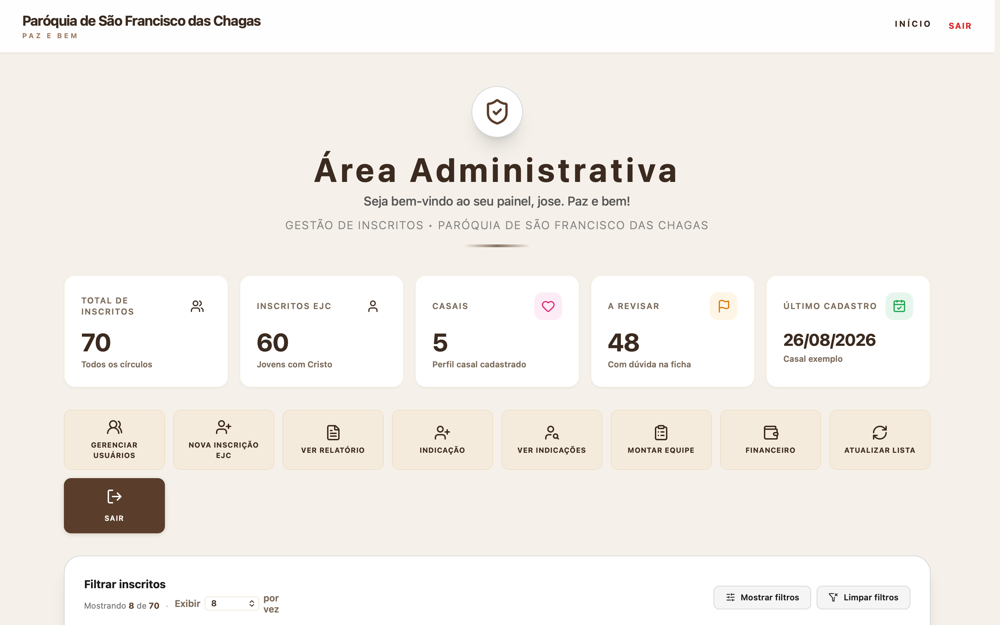
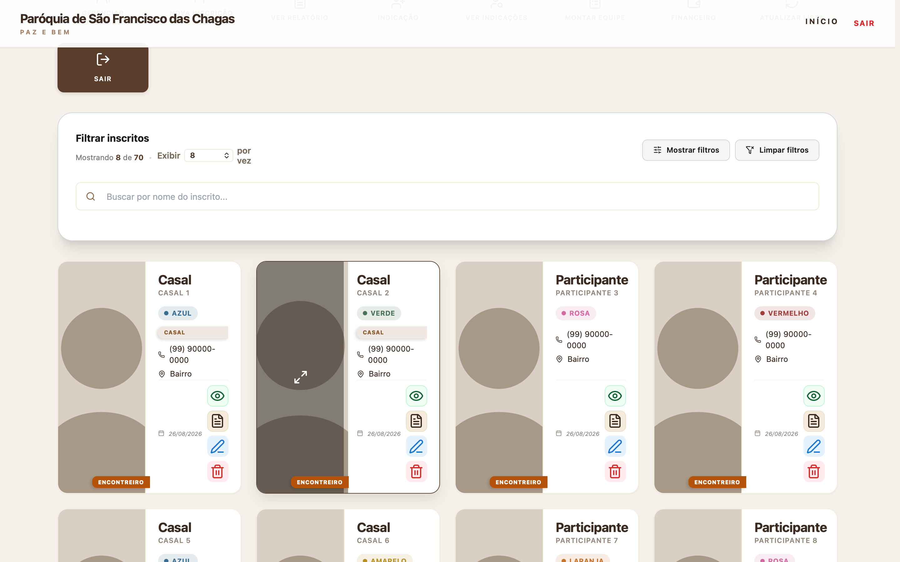

# Parish Registration System (EJC)

Registration and participant management system for the **São Francisco das Chagas Parish** in Brazil, used for its youth retreat **EJC** (Encontro de Jovens com Cristo). It replaced paper forms and spreadsheets.

**Live:** [ejcsfc.org](https://ejcsfc.org)

| Public home | Admin dashboard |
|---|---|
|  |  |

### Participant cards

*Names, phone numbers, neighborhoods and photos in the screenshots were replaced with placeholders to protect participants' privacy.*

## Features

- **Online registration wizard:** a 9-step form with a progress bar, replacing a long paper form.
- **Volunteer self-registration:** two profiles (single youth / couple) that change fields, labels and validation on the fly.
- **Admin panel:** dashboard with clickable cards that act as filters, advanced filters, incremental pagination, approve/reject/edit, and printable forms (PDF).
- **Paper to digital:** 60 handwritten forms were digitized and imported into the database, with every uncertain field flagged for review.
- **Security:** Supabase Row Level Security audited and locked down, so the public can only submit, never read, personal data; admin actions go through dedicated RPC functions.
- **Daily database backup** to a separate Linux server.

## Stack

- **Frontend:** HTML, CSS and vanilla JavaScript
- **Backend / database:** Supabase (PostgreSQL, RLS, RPC functions, storage)
- **Hosting:** Vercel, with a daily `pg_dump` backup to a VPS

---

Volunteer project for my local parish.

Built by [José Henrique Rodrigues](https://www.linkedin.com/in/josehenriquerodrigues-dev) · SmartHelp LTDA
